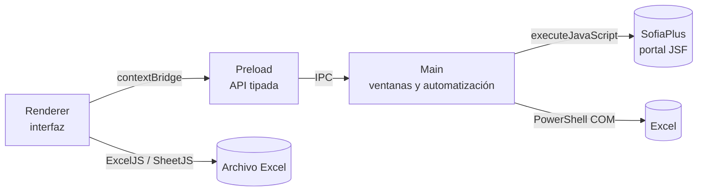

<div align="center">

# AIA

### Ahorro Instructor Automatizado

Aplicación de escritorio para automatizar la consulta de tiempos de instructores en **SofiaPlus (SENA)** a partir de una nómina en Excel.

[](https://nodejs.org/)
[](https://www.electronjs.org/)
[](https://www.typescriptlang.org/)
[](https://opensource.org/licenses/ISC)

</div>

> Proyecto independiente, no afiliado oficialmente al SENA. Úsalo únicamente con credenciales propias y respetando las políticas de uso de SofiaPlus y de la institución.

---

## Tabla de contenidos

- [Descripción general](#descripción-general)
- [Características principales](#características-principales)
- [Flujo de trabajo](#flujo-de-trabajo)
- [Tecnologías](#tecnologías)
- [Requisitos](#requisitos)
- [Instalación](#instalación)
- [Uso](#uso)
- [Scripts](#scripts)
- [Arquitectura](#arquitectura)
- [Estructura del proyecto](#estructura-del-proyecto)
- [Helpers inyectados en la página](#helpers-inyectados-en-la-página)
- [Configuración](#configuración)
- [Estado del proyecto y limitaciones](#estado-del-proyecto-y-limitaciones)
- [Contribución](#contribución)
- [Licencia](#licencia)
- [Autor](#autor)

---

## Descripción general

**AIA** automatiza el recorrido que un instructor realiza manualmente en SofiaPlus para consultar sus tiempos de formación: inicio de sesión, navegación por el portal, selección del rango de fechas, búsqueda por cédula y lectura de las horas reportadas.

A partir de una nómina en Excel, la aplicación:

1. Extrae las cédulas de los instructores.
2. Presenta una vista previa del archivo y permite filtrar y seleccionar instructores.
3. Ejecuta la consulta en una ventana visible del portal, mostrando el avance paso a paso.
4. Escribe las horas encontradas en una copia del Excel, conservando el diseño y los filtros cuando el entorno lo permite.
5. Ofrece el archivo actualizado para descargar.

La automatización está pensada para reducir el trabajo repetitivo y los errores de transcripción, no para reemplazar la revisión humana de los resultados.

## Características principales

- **Procesamiento de nóminas `.xls` y `.xlsx`** con validación de la columna de cédula.
- **Vista previa por hojas**, búsqueda por nombre o documento, filtros por programa y por horas, y selección múltiple de instructores.
- **Automatización visible** de SofiaPlus con banner de progreso dentro del portal y barra de estado en la aplicación.
- **Consulta secuencial de varios instructores**, reabriendo el formulario del reporte entre cada uno.
- **Pausa y reanudación** de la automatización desde la barra inferior.
- **Escritura de horas en Excel** con tres rutas de respaldo para maximizar la compatibilidad.
- **Coloreado de horas** según el umbral configurado: rojo por debajo, verde desde el umbral.
- **Sesión aislada del portal**: cookies, almacenamiento local y caché se limpian antes y después de cada ejecución.
- **Credenciales no persistentes**: se solicitan en cada ejecución y no se guardan en disco.
- **Interfaz de escritorio oscura** con barra de título nativa, selector de meses del periodo de automatización y notificaciones del sistema.
- **Verificación automática de helpers inyectados** para evitar fallos que TypeScript no puede detectar.

## Flujo de trabajo

### 1. Carga y validación del Excel

La aplicación busca la columna de cédula usando los encabezados `Columna 3` o `# DE DOCUMENTO`. Si el archivo no contiene esa columna en ninguna hoja, se rechaza con un mensaje explícito.

Después de la validación se muestra una vista previa con todas las hojas del libro y se generan los carnets de los instructores encontrados.

### 2. Automatización de SofiaPlus

Al iniciar la ejecución, la aplicación abre una ventana visible del portal y recorre este flujo:

| #   | Paso                          | Acción                                                 |
| --- | ----------------------------- | ------------------------------------------------------ |
| 1   | Credenciales                  | Rellena usuario y contraseña e inicia sesión           |
| 2   | Menú Aspirante                | Abre el selector de rol                                |
| 3   | Gestión Desarrollo Curricular | Valida el acceso al módulo                             |
| 4   | Gestión de Ambientes          | Abre el módulo de ambientes                            |
| 5   | Gestión Ambientes             | Entra a la opción de ambientes                         |
| 6   | Reportes                      | Abre el módulo de reportes                             |
| 7   | Consulta de Tiempos           | Abre la consulta de tiempos por actividad de formación |
| 8   | Rango de fechas               | Escribe la fecha inicial y final                       |
| 9   | Actividad de Formación        | Selecciona `RESULTADOS DE APRENDIZAJE`                 |
| 10  | Programa de formación         | Abre el selector de programa                           |
| 11  | Tipo de identificación        | Selecciona `Cédula de ciudadanía`                      |
| 12  | Identificación                | Escribe la cédula del instructor                       |
| 13  | Consultar                     | Pulsa el botón de búsqueda del diálogo                 |
| 14  | Resultado                     | Selecciona el enlace del instructor encontrado         |
| 15  | Consultar reporte             | Ejecuta la consulta definitiva del reporte             |
| 16  | Horas                         | Lee las horas adicionales del resultado                |

Para varios instructores, los pasos **7 a 16 se repiten** por cada cédula seleccionada. El flujo se detiene de forma controlada si una consulta falla y conserva el resultado de las consultas anteriores.

### 3. Escritura de horas en el Excel

La actualización intenta las siguientes rutas en orden:

1. **Excel COM mediante PowerShell** — solo disponible en Windows con Microsoft Excel instalado. Es la ruta que mejor conserva diseño, filtros y formato original.
2. **ExcelJS** — modifica el libro directamente desde JavaScript y conserva la mayor parte del formato.
3. **Reconstrucción con SheetJS** — último recurso, pensado para archivos `.xls` que ExcelJS no puede leer. Puede perder parte del diseño original, y la aplicación lo advierte en el estado.

En todos los casos se conservan las filas del archivo original; la automatización solo escribe las horas de los instructores consultados.

## Tecnologías

| Tecnología       | Versión | Uso                                                    |
| ---------------- | ------- | ------------------------------------------------------ |
| Electron         | 43.4.1  | Contenedor de la aplicación de escritorio              |
| TypeScript       | 6.0.3   | Tipado estricto en todo el proyecto                    |
| esbuild          | 0.28.2  | Empaquetado de los tres procesos y modo desarrollo     |
| ExcelJS          | 4.4.0   | Lectura y edición de libros `.xlsx`                    |
| SheetJS (`xlsx`) | 0.18.5  | Lectura de nóminas y reconstrucción de archivos `.xls` |
| ESLint           | 10.8.1  | Lint con `typescript-eslint`                           |
| Prettier         | 3.9.6   | Formateo de código                                     |
| tsx              | 4.23.15 | Ejecución de los scripts de compilación y verificación |

`tsconfig.json` activa el modo estricto completo, incluidos `noUncheckedIndexedAccess`, `noImplicitReturns` y `noUnusedLocals`.

## Requisitos

| Componente        | Requisito                                                          |
| ----------------- | ------------------------------------------------------------------ |
| Node.js           | ≥ 20 (desarrollado sobre 24.20.0)                                  |
| npm               | ≥ 10                                                               |
| Sistema operativo | Windows, macOS o Linux                                             |
| SofiaPlus         | Cuenta con acceso a _Gestión Desarrollo Curricular_                |
| Microsoft Excel   | Opcional. Recomendado en Windows para conservar el diseño al 100 % |

Sin Microsoft Excel, la aplicación utiliza ExcelJS o SheetJS como respaldo. La ruta COM de Windows es la única que garantiza una conservación completa del formato original.

## Instalación

```bash
git clone https://github.com/OscarFernandomunoz/sena-2026-project.git
cd sena-2026-project
npm install
npm start
```

`npm start` ejecuta el lint, compila los tres procesos y abre Electron.

### Desarrollo con recarga

```bash
npm run dev
```

Compila en modo watch y reinicia Electron cuando cambia un archivo TypeScript. Los cambios en HTML o CSS requieren volver a ejecutar el proceso de desarrollo, porque el watcher actual solo observa `.ts`.

## Uso

1. Abre la aplicación con `npm start` o `npm run dev`.
2. Introduce tus credenciales de SofiaPlus y el rango de fechas.
3. Arrastra o selecciona la nómina en Excel.
4. Revisa la vista previa y selecciona los instructores que quieres consultar.
5. Pulsa el botón de inicio de la barra inferior.
6. Observa el avance en la ventana del portal y en la barra de estado.
7. Al terminar, descarga el archivo actualizado desde el botón de descarga.

La automatización se puede pausar y reanudar desde la barra inferior. La ventana del portal se cierra y su sesión se limpia al finalizar, tanto si la ejecución termina correctamente como si falla.

## Scripts

| Comando                    | Descripción                                                       |
| -------------------------- | ----------------------------------------------------------------- |
| `npm start`                | Lint + compilación + arranque de Electron                         |
| `npm run dev`              | Compilación en watch con reinicio automático de Electron          |
| `npm run build`            | Verificación de tipos, chequeo de helpers y compilación a `dist/` |
| `npm run watch`            | Compilación de desarrollo sin minificar, sin lanzar Electron      |
| `npm run lint`             | ESLint sobre todo el repositorio                                  |
| `npm test`                 | Verifica que los helpers inyectados sigan siendo autocontenidos   |
| `npm run check:serialized` | Alias explícito de `npm test`                                     |

> `npm run watch` realiza una compilación de desarrollo, pero no queda observando cambios. Para recarga automática usa `npm run dev`.

## Arquitectura

La aplicación sigue el modelo de tres procesos de Electron, más un directorio compartido:



- **`main`** — ventanas, apariencia, canales IPC y automatización del portal.
- **`preload`** — expone `window.electronAPI` mediante `contextBridge`. Es el único puente entre el renderer y el proceso principal.
- **`renderer`** — interfaz de usuario. No tiene acceso a Node.
- **`shared`** — tipos y constantes que deben coincidir entre procesos.

### Modelo de seguridad

Las ventanas principales y la del portal se crean con una configuración restrictiva:

```ts
webPreferences: {
  contextIsolation: true,
  nodeIntegration: false,
  sandbox: true,
  devTools: !app.isPackaged,
}
```

El renderer solo puede invocar los canales IPC declarados explícitamente en el preload. Cada mensaje comprueba que venga del frame superior del HTML local y cada payload se normaliza antes de usarlo: credenciales, avisos y libros de Excel tienen forma, longitud y tipo conocidos.

La navegación de la ventana del portal y de sus emergentes se limita al dominio `senasofiaplus.edu.co`. Los permisos web (cámara, micrófono, portapapeles, dispositivos) y las descargas iniciadas por el portal se deniegan por defecto. La sesión de SofiaPlus vive en una partición aislada y se limpia antes y después de cada ejecución.

En la app empaquetada las DevTools están desactivadas. Los mensajes del renderer no se escriben en su consola: viajan por IPC al proceso principal y aparecen en la terminal, junto con los del resto de la aplicación. Los libros temporales que usa Excel COM se crean con permisos restringidos y se borran siempre al terminar.

> **Limitación del portal:** SofiaPlus solo responde por HTTP (`http://senasofiaplus.edu.co`), no por HTTPS. Las credenciales viajan sin cifrar entre el equipo y el servidor del SENA. La aplicación no puede resolverlo desde el cliente: usa una red de confianza, evita redes Wi-Fi públicas y no compartas tu sesión.

### Salida de compilación

```text
dist/
├── main/index.js       # ESM  (proceso principal)
├── preload/index.js    # CJS  (preload)
└── renderer/index.js   # ESM  (renderer)
```

> **El preload debe compilarse como CommonJS.** Electron lo ejecuta en un sandbox que no admite ESM; con `format: 'esm'` y `sandbox: true` la carga falla y `window.electronAPI` queda indefinido.

## Estructura del proyecto

```text
src/
├── main/                      # Proceso principal
│   ├── index.ts               # Arranque de la aplicación
│   ├── ipc/                   # Canales IPC por dominio
│   ├── services/
│   │   ├── sofia-plus/        # Automatización del portal
│   │   ├── spreadsheet/       # Escritura de horas con Excel
│   │   ├── notifications/     # Avisos del sistema
│   │   └── platform/          # PowerShell, WSL e identidad de Windows
│   └── windows/               # Barras de título, paleta y ciclo de vida
├── preload/
│   └── index.ts               # Puente seguro renderer -> main
├── renderer/
│   ├── index.html             # Shell mínimo con directivas @include
│   ├── partials/              # Secciones HTML de la interfaz
│   ├── index.ts               # Arranque del renderer
│   ├── app/                   # Tipos del DOM y del estado
│   ├── features/              # Automatización, instructores, Excel, meses y tema
│   ├── shell/                 # Barra de título y ventana de vista previa
│   └── styles/                # CSS modular con barriles por dominio
└── shared/                    # Tipos y constantes compartidos
```

Además, `scripts/` contiene la compilación, el modo desarrollo y la verificación de helpers; `public/` los recursos estáticos; y `docs/` la documentación de arquitectura.

El detalle completo está en [`docs/architecture.md`](docs/architecture.md); las convenciones de estructura que sigue el repositorio, en [`AGENTS.md`](AGENTS.md).

## Helpers inyectados en la página

Es la parte más delicada del proyecto. Los módulos `login.ts`, `navigation/` y `report/` exportan funciones que el proceso principal serializa con `Function.prototype.toString()` y ejecuta **dentro de la página de SofiaPlus** mediante `executeJavaScript`.

El código inyectado no tiene acceso al ámbito del módulo del que salió, por lo que cada función debe ser **autocontenida**:

- No puede usar imports en tiempo de ejecución (solo `import type`, que TypeScript borra).
- No puede leer constantes ni variables de su módulo.
- No puede llamar a otro módulo.
- Los helpers auxiliares van **dentro** del cuerpo de la función.

TypeScript y ESLint no detectan este tipo de dependencias. Para cubrir ese hueco, `npm run check:serialized` compila los módulos con la configuración real de esbuild y evalúa cada función en un contexto sin módulos. La verificación se ejecuta dentro de `npm run build`, de modo que una dependencia accidental rompe la compilación en lugar de fallar en producción.

## Configuración

| Constante                | Archivo                                              | Para qué sirve                                                   |
| ------------------------ | ---------------------------------------------------- | ---------------------------------------------------------------- |
| `SOFIA_PUBLIC_URL`       | `shared/sofia.ts`                                    | URL del portal                                                   |
| `SOFIA_PARTITION`        | `shared/sofia.ts`                                    | Sesión aislada del portal                                        |
| `TOTAL_STEPS`            | `services/sofia-plus/workflow/step-banner.ts`        | Total de pasos del flujo (16)                                    |
| `ACTION_DELAY_MS`        | `services/sofia-plus/browser/timing.ts`              | Espera entre acciones (800 ms)                                   |
| `DEMO_MODE`              | `services/sofia-plus/browser/click.ts`               | Marca la posición del clic sin ejecutarlo; debe estar en `false` |
| `HOURS_THRESHOLD`        | `renderer/features/spreadsheet/helpers.ts`           | Umbral de horas para colorear (160 h)                            |
| `REQUIRED_COLUMN_NUMBER` | `renderer/features/spreadsheet/preview/constants.ts` | Columna de la que se extrae la cédula (3)                        |

## Estado del proyecto y limitaciones

El proyecto está en desarrollo activo y cubre el flujo principal de consulta y escritura de horas. Antes de usarlo en un entorno real conviene tener en cuenta:

- **El portal puede cambiar.** Los selectores y el flujo dependen de la estructura del DOM de SofiaPlus. Cualquier cambio en el portal puede requerir ajustar `report/` y `navigation/`.
- **La automatización es visible.** La ventana del portal se abre en primer plano y se cierra al terminar. El usuario puede seguir el avance en el banner inyectado en la página.
- **La sesión se limpia en cada corrida.** Se eliminan cookies, almacenamiento local, caché y credenciales de la partición aislada del portal. Los archivos temporales del Excel también se borran al terminar.
- **Sin integración continua.** No hay workflows de GitHub Actions; la verificación depende de ejecutar `npm run build` antes de publicar.
- **La interfaz usa tema oscuro.** La barra de título nativa se sincroniza con ese tema.
- **El portal no ofrece HTTPS.** Consulta la advertencia de la sección [Modelo de seguridad](#modelo-de-seguridad) antes de introducir credenciales reales.
- **La ruta COM depende de Windows y Excel.** En otros sistemas se usa ExcelJS o SheetJS; el resultado puede no conservar todo el formato original.

## Contribución

1. Haz un fork y crea una rama desde `main`.
2. Ejecuta `npm run build` antes de abrir un PR: incluye la verificación de tipos y el chequeo de helpers inyectados.
3. Si tocas los módulos que se inyectan en la página, no te saltes `npm test`.
4. Respeta las convenciones de estructura descritas en [`AGENTS.md`](AGENTS.md).
5. Usa [Conventional Commits](https://www.conventionalcommits.org/):

   ```text
   feat(sofia): validar el programa de formación antes de consultar
   fix(windows): corregir el overlay en pantallas HiDPI
   refactor(renderer): extraer la barra de progreso a su propio módulo
   docs(readme): documentar la ruta de respaldo de Excel
   ```

## Licencia

Distribuido bajo la licencia **ISC**. Consulta [`package.json`](package.json) para los detalles.

## Autor

**Oscar Fernando** — [github.com/OscarFernandomunoz](https://github.com/OscarFernandomunoz)

---

<div align="center">
  <sub>Desarrollado para automatizar la gestión de tiempos de instructores en SofiaPlus.</sub>
</div>
